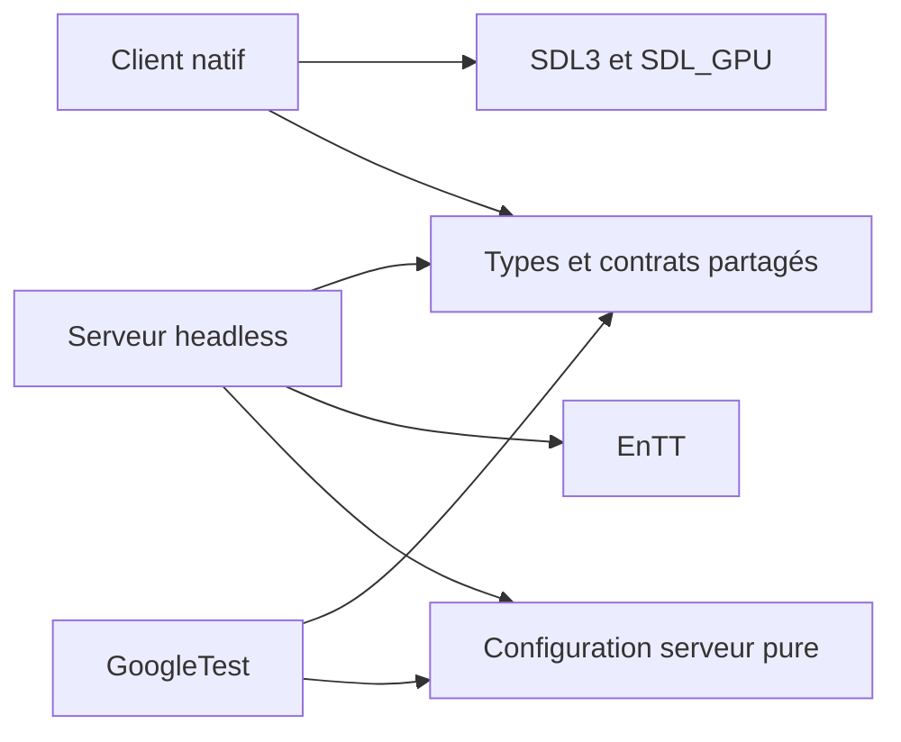

# Architecture du monorepo

## Socle livré et frontière de phase

Le dépôt initial était vide, sans métadonnées Git. Le projet est natif C++23 ; aucun code ni dépendance du prototype Go/TypeScript n'est conservé. La phase 01 fournit la scène locale ; la phase 02 ajoute le réseau autoritaire décrit dans [phase02-network.md](phase02-network.md). Les paragraphes de planification ci-dessous sont complétés par cette description de l'implémentation actuelle.

```text
apps/
  client/        fenêtre, entrées SDL3, API SDL_GPU
  server/        monde EnTT autoritaire, transport, configuration, horloge fixe
shared/
  include/       types et contrats indépendants des plateformes
protocol/        contrats Protocol Buffers versionnés et codec validé
content/         cartes et sprites statiques, séparés des états
tests/           GoogleTest et tests d'exécutables CTest
cmake/           options de build et résolution des dépendances
tools/           bootstrap et audit du registre vcpkg
docs/            conception, décisions, build et validation
.tools/          outils téléchargés, sources vcpkg et caches, ignorés par Git
out/             builds et dépendances compilées, ignorés par Git
```

`tchips_client` et `tchips_server` sont deux exécutables séparés. Le client charge les assets, ouvre SDL_GPU et prédit les intentions ; le serveur headless possède une zone EnTT et calcule les positions définitives à 30 Hz. Les adaptateurs réseau utilisent GameNetworkingSockets et Protobuf, sans appels de transport dans le domaine `World`.

`tchips_geometry` contient le chargement/empreinte de carte et la résolution géométrique des collisions. `tchips_server_world` possède les règles autoritaires et files de commandes ; `tchips_server_network` gère sessions, quotas, handshake et visibilité. `tchips_client_core` contient la prédiction et l'interpolation testables sans SDL ; `tchips_client_network` adapte les snapshots et intentions. Aucun moteur de gameplay complet n'est partagé.

La phase 01 sépare `tchips_client_core` (Camera2D, WorldMap, CollisionSystem, MovementSystem et AssetManager, sans SDL) de `tchips_client_platform` (Application, Renderer et InputManager). Les tests du core sont aussi construits dans le preset headless Linux sans ajouter SDL. Les contrats de géométrie fortement typés restent dans `shared/`, sans logique de mouvement partagée avec le serveur. Voir [phase01-client.md](phase01-client.md).

## Graphe des dépendances



Les bibliothèques partagées restent limitées aux contrats, types, mathématiques et géométrie. Les règles autoritaires vivent uniquement dans les modules serveur. La prédiction client est limitée au déplacement et vérifiée par des scénarios de convergence ; aucune simulation complète n'est partagée.

## Extensions prévues, non implémentées

- Serveur : plusieurs zones/instances et persistance libpqxx. L'adaptateur réseau actuel et le futur adaptateur SQL entourent le domaine ; aucun appel de socket/SQL dans un système de gameplay.
- Client à venir : sprites texturés/animés, UI RmlUi et audio miniaudio. Un adaptateur de rendu RmlUi vers SDL_GPU devra être développé et testé ; aucune compatibilité automatique n'est supposée.
- Entités : EnTT pour les composants et leurs systèmes ; contenu immuable distinct des composants temporaires et des agrégats durables.
- Réseau actuel : Protocol Buffers pour les schémas, GameNetworkingSockets pour le transport, handshake, deux clients et reconnexion. Authentification et changement de zone restent futurs.
- Persistance : PostgreSQL/libpqxx, transactions avec invariants métier, migrations versionnées et idempotence. Aucun compte, inventaire, compétence ou schéma SQL dans ce socle.

`TCHIPS_ENABLE_NETWORK` active l'implémentation réseau. Les autres fonctionnalités CMake optionnelles réservent les dépendances futures sans en inventer les systèmes.

## Temps, budgets et observabilité

La fréquence est de 30 Hz, définie par les constantes de configuration. `World::step` avance un tick sans consulter l'horloge réelle. Le temps réel et le sommeil sont du ressort du bootstrap. Le rattrapage est borné : après un retard supérieur à un pas, le calendrier est recalé. Ce choix peut ralentir la simulation sous surcharge et devra être mesuré avant gameplay.

Les exécutables journalisent leur initialisation, les erreurs fatales et le nombre de frames/ticks à l'arrêt. L'option Tracy instrumente les boucles ; un collecteur et des métriques de durée de tick, retard, files, entités et trafic viendront dans la phase de simulation. Aucun débit de 1 000 joueurs n'a été démontré.

## Sécurité et cycle de vie

Le client n'a aucune autorité de résultat. Le transport borne tailles/files et impose quotas, version, validation des champs et séquences. Une déconnexion retire session, entité et commandes en attente ; les reconnexions créent une nouvelle identité temporaire. L'authentification n'est pas implémentée.

Le client utilise RAII : libération de la fenêtre du périphérique GPU, destruction du périphérique, de la fenêtre puis SDL_Quit. Une swapchain temporairement indisponible n'est pas une déconnexion. Les erreurs GPU produisent un journal et un code de sortie non nul, sans remplacement silencieux du moteur de rendu.
